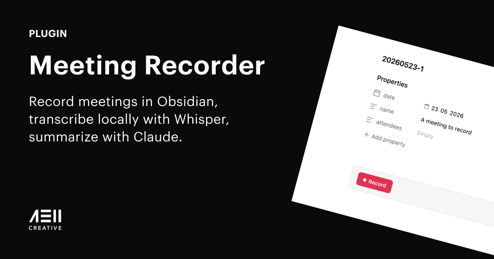

# Meeting Recorder

An Obsidian plugin that records meetings, transcribes them live with [Whisper](https://github.com/ggml-org/whisper.cpp), and generates a structured summary with [Claude](https://claude.com/claude-code) — all locally, in the current note.

Works on **macOS** and **Windows** (desktop only).

## What it does

Insert a recorder into any note via the command palette → **Insert Meeting Recorder**, hit **Record**, talk. While you record, Whisper transcribes chunks every 30s and writes them straight into the note. On **Stop**, the transcript is folded into a `> [!quote]- Transcript` callout and Claude appends a summary with action items, decisions, and notes.

Works especially well dropped into a meeting template — the recorder lives in the note itself, so each new meeting starts ready to go.

## Install

1. Clone or download this repo.
2. Copy `main.js`, `manifest.json`, and `styles.css` into `<your-vault>/.obsidian/plugins/meeting-recorder/`. On macOS also copy `meeting-tap` (the system-audio helper, built with `npm run build:native`).
3. Enable **Meeting Recorder** in Obsidian → Settings → Community plugins.

## Prerequisites

You need these installed and on your `PATH`:

| Tool | Purpose | Install |
|------|---------|---------|
| [whisper.cpp](https://github.com/ggml-org/whisper.cpp) | Local transcription (provides `whisper-cli`) | macOS: `brew install whisper-cpp` · Windows: build from source or grab a release binary |
| A Whisper GGML model | Used by `whisper-cli` | Download from [Hugging Face](https://huggingface.co/ggerganov/whisper.cpp/tree/main) — e.g. `ggml-large-v3-turbo.bin` |
| [Claude Code CLI](https://docs.claude.com/en/docs/claude-code/quickstart) | Summary generation | `npm install -g @anthropic-ai/claude-code`, then run `claude` once to sign in |

For **system audio capture** (recording the other side of a call, not just your mic):

| Platform | Tool | Install |
|----------|------|---------|
| macOS 14.2+ | Bundled `meeting-tap` helper (Core Audio process tap) | Nothing to install |
| Windows | [VB-CABLE](https://vb-audio.com/Cable/) | Download installer from VB-Audio |

Mic-only recording works with no extra setup.

## Configure

In Obsidian → Settings → **Meeting Recorder**:

- **Whisper binary** — usually just `whisper-cli` if it's on PATH.
- **Models directory** — folder containing your `.bin` model files.
- **Audio input** — `mic`, `system`, or `both`.

### macOS — system audio

The plugin runs a small helper, `meeting-tap`, that records everything your Mac plays through a Core Audio process tap. Your output device is never changed, so you keep hearing the call on whatever speakers or headphones you picked, and it doesn't matter which speaker the meeting app is set to.

The first time you record system audio, macOS asks whether Obsidian may record this computer's audio. Allow it. If you denied it, turn it on under System Settings → Privacy & Security → Screen & System Audio Recording.

Upgrading from 0.2 or earlier: BlackHole, SwitchAudioSource and the Multi-Output Devices are no longer used and can be removed.

### Windows — system audio

In Windows sound settings, set your **default playback device** to `CABLE Input (VB-Audio Virtual Cable)` before recording. To still hear the meeting, enable **Listen to this device** on the CABLE Input properties and route it to your real speakers — or use [VoiceMeeter](https://vb-audio.com/Voicemeeter/) for cleaner routing.

The plugin captures from any input device whose name contains `cable` or `vb-audio`.

## Build from source

```bash
npm install
npm run build
npm run build:native   # macOS: universal meeting-tap helper (needs Xcode command line tools)
```

Outputs `main.js` and `meeting-tap` next to `manifest.json` and `styles.css`.

## License

MIT
